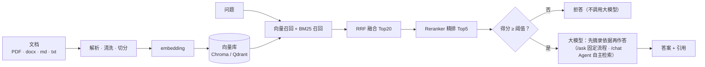

# ragbase

开箱即用的 RAG 服务，**仅提供 RAG 能力**（没有用户体系）：对你的 PDF / Word / Markdown / 文本资料做**混合检索 + 精排 + 低分拒答 + 引用溯源**，带多轮**对话 Agent** 和 **Web 界面**，通过命令行或 HTTP API 使用。检索得分不够就老实拒答、不调用大模型；回答先逐字摘录依据再作答，每句话都能追溯到文件、页码和章节。

## 特性

- **混合检索**：向量召回 + BM25（jieba 中文分词）两路，RRF 融合，再用 reranker 精排；支持按书（文件）过滤。
- **低分拒答与幻觉抑制**：最相关片段得分低于阈值直接拒答；只把足够相关的片段交给大模型；“先摘录依据，再回答”。
- **引用溯源**：回答带 `[n]` 引用，对应文件名、页码、PDF 书签章节路径和各路得分。
- **对话 Agent**：多轮追问、按需检索、会话级引用编号、流式输出（SSE）。
- **增量入库**：新增 / 修改 / 删除自动识别；服务在线时可通过 Web 界面或 API 上传文档。
- **模型可本地可云端**：embedding / reranker 可选本地 Qwen3（Apple Silicon / CUDA / CPU）或云端 API；大模型走任意 OpenAI 兼容服务。
- **向量库可插拔**：Chroma（默认）/ Qdrant（嵌入式或服务端），可无损迁移。
- **安全默认**：可选静态 API Key 鉴权（默认拒绝 + 公开白名单）、CORS、`ragbase doctor` 体检。
- **评测**：Ragas、无需大模型的词面指标、拒答阈值校准脚本。

## 架构



细节见 [docs/architecture.md](docs/architecture.md)。

## 快速开始

你需要：**一个 OpenAI 兼容的大模型服务**（OpenAI、DeepSeek、通义、火山方舟、本地 Ollama / vLLM 等；地址 `RAG_LLM_BASE_URL`、密钥 `RAG_LLM_API_KEY`、模型名 `RAG_LLM_MODEL`，不配也能启动和检索，只是不能问答 / 对话）、**你的资料**，以及用本地模型时约 2.2 GB 磁盘（首次下载一次；也可以改用云端 embedding / reranker，不用下载）。三条路径任选其一，最后浏览器打开 <http://127.0.0.1:8000/>。

### 路径 A：Docker Compose（CPU 版，不用装 Python / Node）

```bash
cp .env.example .env              # 编辑 .env：填 RAG_LLM_*；对外开放服务必须设置 RAG_API_KEY
mkdir -p ragbase-home/data        # 项目主目录（挂载为容器内 /data）；把文档放进 ragbase-home/data/
docker compose run --rm ragbase models download   # 首次：下载模型到 ragbase-models 卷（约 2.2 GB）
docker compose run --rm ragbase ingest            # 建立索引
docker compose up -d --build                      # 启动
```

国内网络下载模型慢：`HF_ENDPOINT=https://hf-mirror.com docker compose run --rm ragbase models download`。卷、端口、Qdrant、新增文档等见 [docs/deployment.md](docs/deployment.md)。

### 路径 B：`scripts/start.sh`（克隆后一键，macOS / Linux）

```bash
git clone <本仓库地址> ragbase && cd ragbase
scripts/start.sh                  # 国内网络：HF_ENDPOINT=https://hf-mirror.com scripts/start.sh
```

依次：检查 `uv` → 安装依赖 → 构建 Web 界面（有 `pnpm` 时）→ 生成 `.env` → 下载模型 → `ragbase doctor` → 启动。可重复运行。首次运行后编辑 `.env`，把文档放进 `data/`，另开终端 `uv run ragbase ingest`，必要时重启服务。

### 路径 C：手动

```bash
uv sync                           # 需要 Python >= 3.12 和 uv（https://docs.astral.sh/uv/）
uv run ragbase init               # 生成 data/、.env、bm25_userdict.txt（不覆盖已有文件）
$EDITOR .env                      # 填 RAG_LLM_BASE_URL / RAG_LLM_API_KEY / RAG_LLM_MODEL
uv run ragbase models download    # 下载 embedding + reranker（已缓存则跳过）
cp ~/你的资料/*.pdf data/          # 放文档（只扫 data/ 顶层；.pdf .docx .md .markdown .txt）
uv run ragbase ingest             # 建立索引（首次会向量化全部文档）
uv run ragbase serve              # http://127.0.0.1:8000/
```

Web 界面需要前端构建产物：`scripts/build_web.sh`（Node 22 + pnpm）；没有构建时 API 仍可用。**不知道哪里没配好：运行 `uv run ragbase doctor`**。

## 最小配置

`ragbase init` 生成的 `.env` 里示例都是注释掉的。**本地模型**（默认）只需要大模型三项：

```dotenv
RAG_LLM_BASE_URL=https://api.openai.com/v1
RAG_LLM_API_KEY=请替换为你的密钥
RAG_LLM_MODEL=gpt-4o-mini
# RAG_API_KEY=                  # 对外开放服务时必填：ragbase init --api-key 或 openssl rand -hex 32
```

**全云端**（无 GPU 的机器：不下载模型、启动时不加载 torch；地址和模型名只是示例，未逐一验证）：

```dotenv
RAG_LLM_BASE_URL=...            # 同上
RAG_LLM_API_KEY=...
RAG_LLM_MODEL=...
RAG_EMBEDDING_PROVIDER=openai
RAG_EMBEDDING_BASE_URL=https://api.siliconflow.cn/v1
RAG_EMBEDDING_API_KEY=请替换为你的密钥
RAG_EMBEDDING_MODEL=BAAI/bge-m3
RAG_RERANKER_PROVIDER=api
RAG_RERANKER_BASE_URL=https://api.siliconflow.cn/v1
RAG_RERANKER_API_KEY=请替换为你的密钥
RAG_RERANKER_MODEL=BAAI/bge-reranker-v2-m3
```

换 embedding 必须 `ragbase ingest --full` 重建索引；换 reranker 要重新标定拒答阈值，见 [docs/models.md](docs/models.md)。全部配置项见 [docs/configuration.md](docs/configuration.md)，模板见 [.env.example](.env.example)。

## 使用

```bash
uv run ragbase ask                       # 命令行问答（--mode / --min-score / --source …）
uv run ragbase chat                      # 命令行多轮对话（/new 新会话，exit 退出）
uv run ragbase ingest                    # 增量入库；ingest --full 全量重建
uv run ragbase eval --retrieval-only     # 评测（不调用大模型）
uv run ragbase --help                    # 全部子命令：init models doctor serve ingest ask chat eval migrate-store
```

```bash
curl -s -X POST http://127.0.0.1:8000/ask -H 'Content-Type: application/json' \
  -d '{"query": "关键路径法怎么计算总浮动时间"}'          # 启用鉴权时加 -H "Authorization: Bearer $RAG_API_KEY"
```

服务运行时 <http://127.0.0.1:8000/docs> 是交互式 API 文档。

## 文档

| 文档 | 内容 |
| --- | --- |
| [docs/configuration.md](docs/configuration.md) | 全部配置项（由 `Settings` 生成）、优先级、`RAG_HOME` |
| [docs/models.md](docs/models.md) | 本地 / 云端模型、示例组合、HF 镜像、索引签名规则、阈值重新标定、硬件 |
| [docs/api.md](docs/api.md) | 全部 HTTP 接口、鉴权、错误格式、SSE 事件、引用编号 |
| [docs/deployment.md](docs/deployment.md) | Docker Compose、start.sh、反向代理 / HTTPS、安全清单、备份、升级 |
| [docs/architecture.md](docs/architecture.md) | 解析 / 切分 / 增量入库 / 混合检索 / 拒答 / Agent / 向量库 / 模块地图 |
| [docs/evaluation.md](docs/evaluation.md) | 评测指标、运行方式、题集格式、校准工作流 |
| [docs/development.md](docs/development.md) | 开发环境、前端、测试、CI、约定、如何扩展 |
| [docs/troubleshooting.md](docs/troubleshooting.md) | 常见问题与排错 |
| [CHANGELOG.md](CHANGELOG.md) | 更新日志 |

## 重要提示

- **对外开放必须设置 `RAG_API_KEY`**（监听 `0.0.0.0` / Docker 发布到非本机 / 公网）。否则任何能访问端口的人都能查询你的知识库、消耗你的大模型额度、上传 / 删除文档；并放在 HTTPS 反向代理后面（密钥是明文 Bearer 令牌）。见[安全清单](docs/deployment.md#安全清单)。
- **服务运行期间不要运行 `ragbase ingest --full`**（会清空整个向量库，而服务进程还持有该索引）；增量 `ragbase ingest` 也不要与服务同时运行。服务在线时用 Web 界面“知识库”页或 `POST /documents` / `POST /ingest`。
- **嵌入式 Qdrant**（只设 `RAG_VECTOR_STORE=qdrant`）同一目录同一时刻只允许一个进程写，不能和运行中的 `serve` 同时跑 `ingest` / `migrate-store`。
- 服务**必须单进程**，不要加 `--workers`。
- 命令在**项目主目录**（`RAG_HOME`，默认当前目录）下读写 `data/`、索引和 `.env`；在别的目录运行请先设置 `RAG_HOME`。
- 不会自动 OCR：扫描版 PDF（没有文本层）需要先自行做 OCR。

## 项目状态

- **尚未发布**（版本 `0.1.0`，见 [CHANGELOG.md](CHANGELOG.md)），接口和配置在 1.0 之前可能变化。
- **Docker 文件（`Dockerfile`、`docker-compose.yml`）尚未在真实环境验证镜像构建和运行**，只做过静态校验。
- 对话 Agent 依赖模型的工具调用能力，单元测试用的是假模型，**未用真实大模型验证**；Agent 的系统提示词里目前写着作者语料（《系统架构设计师》《信息系统项目管理师》教材）的领域文案，换领域请改 `agent/service.py` 与 `agent/tools.py`。
- 本地模型在 Apple Silicon（MPS）上日常使用；CUDA 路径代码支持但未实测；云端服务商的具体地址 / 模型 ID 均为示例，未逐一验证。
- 默认拒答阈值（0.7 / 0.95）按作者语料上的本地 Qwen3-Reranker-0.6B 标定，换语料 / 换 reranker 请用 `scripts/calibrate_rerank_threshold.py` 重新标定。
- 会话只存在服务进程内存里，重启即丢。

## 开发

```bash
uv sync                                  # 开发环境
uv run python tests/run_all.py           # 全部单元测试（不加载模型、不调用真实大模型）
cd web && pnpm install && pnpm dev       # 前端热更新，代理到 127.0.0.1:8000
```

详见 [docs/development.md](docs/development.md)（项目结构、测试约定、CI、如何新增向量库 / 模型提供方）。
