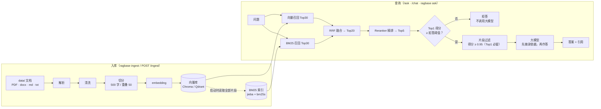

# 架构

ragbase 只做一件事：把你的文档变成可检索、可引用、会拒答的问答能力。这份文档讲流水线每一步在做什么、为什么这样做，最后给出源码模块地图。

## 总览



对话 Agent 在此之上：由大模型决定要不要调用 `search_knowledge`（上图“查询”部分的同一套召回 + 精排 + 拒答 + 过滤），再带 `[n]` 引用作答，并把多轮会话持久化到内置 SQLite 数据库（见[数据库](#数据库)）。

设计取舍：

- **RAG 能力和产品壳分开**：只提供检索 / 问答 / 对话 / 文档入库（外加体检与评测），没有用户、权限、多租户；访问控制只有一把静态共享密钥。
- **拒答优先于编造**：精排得分不够就不调用大模型（省钱，也避免凭空编造）；够了也只给模型足够相关的片段，并要求它逐字摘录依据。
- **单进程**：模型、BM25 索引都加载在服务进程内，用锁和快照保证并发安全，不做多 worker。

## 入库

入库按职责拆在 `src/ragbase/ingest/`：

| 模块 | 职责 |
| --- | --- |
| `parser.py` | 文件格式解析（只产出 LangChain `Document`，不清洗、不切分） |
| `cleaner.py` | 文本规范化、重复页眉页脚和空页清理 |
| `splitter.py` | 递归切分、空片段与重复片段过滤 |
| `toc.py` | PDF 书签 → 每页章节路径（`heading_path`） |
| `common.py` | 稳定 ID、文件指纹、入库编排（`prepare_file_chunks`） |
| `service.py` | 增量入库逻辑（命令行和 HTTP 服务共用；依赖全部显式传入，便于用临时目录 + 假 embedding 测试） |
| `jobs.py` | HTTP 服务里的后台入库任务注册表 |

### 解析

只扫描数据目录**顶层**（不递归），扩展名不区分大小写：

| 格式 | 解析方式 |
| --- | --- |
| `.pdf` | PyMuPDF，每页一个 `Document`，带 0 起的 `page`、`total_pages` 等元数据；加密且无法用空密码解开的 PDF 报错；PyMuPDF 不是线程安全的，解析用全局锁串行化 |
| `.docx` | `docx2txt`，整份文档一个 `Document` |
| `.md` / `.markdown` / `.txt` | 整份文件一个 `Document`；编码依次尝试 UTF-16（带 BOM）、UTF-8（带 / 不带 BOM）、GB18030（含 GBK / GB2312），都不行报错并提示另存为 UTF-8 |

`README.*`（文件名主干为 README）、隐藏文件、Word 临时锁文件（`~$` 开头）不当作文档；旧版 `.doc` 无法解析，会被跳过并提示另存为 `.docx`。**扫描版 PDF（没有文本层）不会自动 OCR**：入库时会提示“文档没有可索引文本，扫描版 PDF 需要 OCR”。

### 清洗

- 规范化：Unicode NFKC、去控制字符、压缩横向空白（含全角空格）、连续空行压成一个。
- 去重复页眉页脚：文档（页）数 ≥ 3 时，统计每个“规范化后长度 4 ~ 80 的非空行”出现在多少页，出现页数 ≥ `max(3, ⌈页数 × 30%⌉)` 的行视为页眉 / 页脚 / 书名，整本删除。
- 清洗后为空的页直接丢弃。

### 切分

`RecursiveCharacterTextSplitter`，`chunk_size = 500`、`chunk_overlap = 50`（按**字符数**），分隔符依次为 `\n\n`、`\n`、`。`、`！`、`？`、`，`、空格、空串。切完后删除文件内部的空片段和（NFKC + 小写 + 去空白后）完全重复的片段。切分参数直接定义在 [`splitter.py`](../src/ragbase/ingest/splitter.py) 里。

### 章节标题（PDF 书签）

[`toc.py`](../src/ragbase/ingest/toc.py) 读取 PDF 书签（目录），给每个片段加上 `heading_path`，如 `第11章 项目成本管理 > 11.3 挣值分析`：

- 对第 p 页，路径 = 起始页不晚于该页的各层级“最近一条”书签标题，用 ` > ` 连接；新书签出现时，同层及更深层的旧标题被替换，所以路径始终是一条自洽的层级链。
- 标题会去首尾空白、压缩空白；纯数字 / 标点的标题（如考试大纲里的 `1`、`3.1`）直接丢弃；没有可用书签（或书签读取失败）则该文件没有章节。**非 PDF 暂无章节**。
- **近似**：书签只记录起始页，不记录页内位置，一节从页中间开始时，整页都归给这一节。
- 向量化输入 = `heading_path + "\n" + 正文`；BM25 分词输入 = `heading_path + " " + 正文`；向量库里存的 `document` 仍是**纯正文**。**精排 reranker 的输入只用正文**——这样按纯正文校准的拒答阈值仍然有效。
- 章节出现在：`/search` 的 `chunks` 和 `/ask` / `/chat` 的 `citations`（`heading_path`，没有为 `null`）、交给大模型的上下文（`[片段1]（第11章 … > 11.3 …）正文`）、命令行来源标签（`xxx.pdf:第12页「11.3 挣值分析」[V2+B1|0.93]`，只显示末级章节）。

### 稳定 ID 与元数据

- `fid` = `md5(文件名)[:16]`（只看文件名，不含路径）；片段 ID = `{fid}_{片段序号}`。同一文件的片段因此可以整批删除 / 重建；**重命名文件 = 删除旧文件 + 新增新文件**。
- 每个片段的元数据有 `source`（原始文件路径）、`fid`、`chunk_index`、`content_hash`（正文 sha256 前 16 位）、`page`（PDF）、`heading_path`（有则写，无则不写该字段——向量库元数据只能是标量）等。对外 `source` 只给文件名（basename），`page` 转成 1 起。

### 增量入库、指纹与任务

`ragbase ingest` 和 `POST /ingest` 共用 [`service.py`](../src/ragbase/ingest/service.py) 的 `run_ingest`：

1. **指纹**：`md5(INGEST_PIPELINE_VERSION | 文件名 | 大小 | int(修改时间))`。不用内容哈希是因为大文件读一遍太慢；代价是只改了修改时间也会被当作变化而重新索引。`INGEST_PIPELINE_VERSION`（解析 / 清洗 / 切分 / 章节规则变化时递增）也在其中，所以升级规则后下次增量入库会重新索引所有文件。
2. **计划**：对比 `.ingest_meta.json`（`{fid: {name, fp}}`）与当前文件，得到“新增 / 修改”“已删除”“未变”。特殊情况：有记录但索引为空 / 缺失 → 全部重建（`index_missing`）；索引非空但没有记录（旧版索引）→ 先按 ID 分批清空旧片段、再逐文件重建（`legacy`，不删除集合）。
3. **逐文件处理**：先 `upsert` 新片段（ID 稳定，同 ID 覆盖），最后才删除不再存在的旧片段，所以重建某个文件期间它仍可被检索。每 64 个片段为一批（向量化 + 写入），**每批单独持有检索锁**，批间释放，所以服务在线入库时 `/search` 可以插进来。
4. **失败语义**：每个文件成功后**立即**把它的指纹写进 `.ingest_meta.json`；失败的文件不记录，下次重试；中途中断时已完成的文件不会重做。有文件失败则命令行退出码为 1。
5. **签名**：第一次写向量之前登记 embedding 签名并校验向量长度，见 [models.md](models.md#换-embedding索引签名规则)。
6. `ragbase ingest --full`：先创建 embedding（失败不会动旧索引），然后**清空整个向量库**，删除 `.ingest_meta.json` 和 `.index_info.json`，再当作全新库入库。

**HTTP 里的后台任务**（[`jobs.py`](../src/ragbase/ingest/jobs.py)）：任务在服务进程的后台线程里跑，状态保存在内存（最多保留最近 100 个）。“忙”由一把不阻塞获取的锁表示：入库任务和删除文档都要先抢它，抢不到就返回 409。任务结束时还要重建 BM25 快照并原子替换，之后才标记 `succeeded`，所以任务显示成功时索引和 BM25 都已是最新。

### 删除

`DELETE /documents/{name}` 删除源文件、索引片段（有 `fid` 的按 `fid`，旧版片段按 `source` 文件名匹配）和入库记录，并同步重建 BM25（分词缓存未命中时可能要几十秒）。

## 混合检索

[`retrieval/hybrid.py`](../src/ragbase/retrieval/hybrid.py) 同时走两路召回，再用 RRF 融合：

- **向量路**：问题经 embedding 后直接查向量库，取 `RAG_PER_ROUTE_K`（30）条。
- **BM25 路**：`jieba` 搜索模式分词 + `bm25s` 打分，同样取 30 条。专有名词、缩写和公式（如 TOGAF、SPI）这类向量容易漏的内容由它补召回。
- **RRF**（倒数排名融合）：`score(id) = Σ 1 / (60 + rank)`，**只看排名不看分数**，所以不需要对向量距离和 BM25 分数做归一化，也因此换向量库后端只要排序正确即可。融合后取前 `RAG_RETRIEVE_K`（20）条交给 reranker。
- 单路模式（`--mode vector` / `bm25`）只走一路，直接取 `RAG_RETRIEVE_K` 条。每个结果的元数据带 `rrf_score`、`vec_rank`、`bm25_rank`（1 起的路内排名，没命中为 `null`）和 `chunk_id`；命令行来源里 `[V3+B1]` 表示向量路第 3、BM25 路第 1。

**分词**：小写；英文单词、数字、缩写（TOGAF、ISO 9001）按原样保留为小写 token；去标点和一小撮高频虚词 / 疑问词（BM25 的 IDF 本身会压低常见词，不需要大停用词表）；单个 ASCII 字符（OCR 噪声、选项 A/B/C）丢弃；被空格拆开的 3 个以上单字母（`T O G A F`）先合并再分词。领域词典 `bm25_userdict.txt` 放在项目主目录（jieba 格式：`词 词频 词性`），**不要放进 `data/`**——那里的 `.txt` 会被当文档入库。修改后下次启动自动生效。

**BM25 索引的来源与缓存**：启动时从向量库已有的片段文本现建（按片段 ID 排序后分词，所以换向量库后端分词缓存仍然有效），无需改动入库流程。分词结果缓存在 `.bm25_cache/tokens-<键>.json`，键 = `md5(分词版本 | 片段数 | 全部片段内容摘要 | 用户词典摘要)`；入库 / 删除 / 章节标题 / 词典变化后自动失效，旧缓存文件会被清掉，目录里最多一份有效缓存。

**快照与原子切换**：BM25 索引、语料和“书目录”（每本书的片段数、章节覆盖）打包成不可变的快照；入库或删除文档后在后台建好新快照，再整体替换一个引用，检索期间不会看到半成品索引。

**按书过滤（`sources`）**：服务端用检索器内存里的语料把书名解析成库里存的 `source` 原始值（旧索引存的是绝对路径，不能自己拼）；向量路让向量库按 `source` 过滤（Chroma 用 `where={"source": {"$in": [...]}}`，Qdrant 用 `MatchAny`），BM25 路用 bm25s 的 `weight_mask`；过滤后没有命中则判定拒答。

## 精排

对召回的候选逐个与问题打相关度分，取前 `RAG_RERANK_K`（5）。输入**只用片段正文**（不拼章节路径）。三种实现（同一接口 `rerank_with_scores`）：

- **本地**（`Qwen3Reranker`）：sentence-transformers `CrossEncoder`。模型原始输出是 “yes” 与 “no” 两个 token 的 logit 之差，经 sigmoid 转成 P(相关) ∈ [0, 1]；批大小 8；mps / cuda 上用 fp16，MPS 上启动时预热 kernel；进程内缓存 128 组结果。
- **云端**（`ApiReranker`）：`POST {地址}/rerank`，分数原样透传，见 [models.md](models.md#云端-rerank-的行为)。
- **none**（`NoReranker`）：保持召回顺序取前 K，分数为 `None`。

召回 + 精排整体在一把锁（`pipeline.lock`）里串行，因为本地模型在 MPS 上不能并发推理；大模型生成在锁外并行，慢生成不会阻塞别的检索。

## 拒答与上下文过滤

两道闸，都在调用大模型**之前**：

1. **拒答**（`should_refuse`）：没有任何精排结果 → 拒答；否则最相关片段的 `rerank_score < min_score`（默认 0.7）→ 拒答。`min_score` 为 `0` 不按得分拒答；**没有得分**（`reranker=none`）时无从比较，也不按得分拒答，只有空召回才拒答。拒答时直接回答固定文案“我没有在文档中找到相关内容。”，**不调用大模型**；`/search` 则返回 `refused=true` 并照常带上 `chunks`。
2. **上下文过滤**（`select_context_docs`）：通过拒答后，只保留 `rerank_score >= context_min_score`（默认 0.95）的片段，**top1 总是保留**；没有得分的片段视为满分保留；`0` 不过滤。默认值的实验依据见 [models.md](models.md#默认阈值是怎么来的本地-qwen3-reranker-06b)：本地 reranker 的得分很饱和，所以该阈值对库内题几乎不裁剪，主要是兜底。

## “先摘录再回答”的提示词

单轮问答（`/ask`、`ragbase ask`）的系统提示词要求模型只根据给定上下文，并按固定格式输出：

```text
【依据】
- [片段N] “逐字摘录的原文”
【回答】
基于依据的回答，句末标注 [片段N]
```

规则：依据必须是片段原文的逐字摘录（每条 ≤ 80 字，最多 5 条）；回答只能使用依据里已有的事实；片段只覆盖问题的一部分时，只回答有依据的部分并指出缺失；所有片段都无关时只回复固定拒答文案。

`split_evidence_answer()` 负责把输出拆成（依据，回答），容忍半角 / 全角括号、`依据：`/`回答：` 标题等写法；**模型没按格式输出时，整段当作回答、依据为空**。`AskResult` 的 `docs` 就是实际交给大模型的片段，`[片段N]` 与它的顺序一一对应，所以 `/ask` 的 `citations[n-1]` 对应 `[片段n]`。评测只用【回答】部分做 Ragas / 裁判，依据单独存进结果的 `evidence` 字段。

## 对话 Agent

在 `/ask`（单轮、固定流程）之外，多轮对话 Agent 由大模型决定是否检索、检索什么，再带 `[n]` 引用作答。代码：[`agent/tools.py`](../src/ragbase/agent/tools.py)（工具与引用登记表）、[`agent/service.py`](../src/ragbase/agent/service.py)（Agent、会话、限制）、[`agent/store.py`](../src/ragbase/agent/store.py)（会话摘要与引用的数据库读写）、命令行 `ragbase chat`。

```text
用户消息 → Agent（LangChain create_agent，基于 LangGraph）─┬→ search_knowledge(query, sources?) → 召回 + 精排 + 拒答 / 上下文过滤（同 /ask）
                                                          ├→ list_documents()                  → 书目与片段数
                                                          └→ 最终回答（[n] 引用）
会话历史：SqliteSaver（同一个 ragbase.db），thread_id = session_id
```

- **工具**：`search_knowledge` 检索，结果格式为 `[n] 来源：《书名》> 章节路径（第N页）` + `内容：…`；被拒答时返回“知识库中没有找到可靠的相关内容……”，让模型直接告诉用户而不是编造。`list_documents` 列出书目（供模型用 `sources` 限定范围）。`sources` 里有未知书名时不抛异常，而是把可选项告诉模型让它自己纠正。
- **多轮改写**不单独做一步：工具描述要求模型把 `query` 写成自包含的完整问题（补全代词 / 省略），检索直接用它。
- **会话记忆与持久化**：历史由 LangGraph 的 SQLite checkpointer（`langgraph-checkpoint-sqlite`）保存在内置数据库里，**重启不丢**；会话摘要（标题、更新时间、消息数）在 `chat_sessions` 表，引用编号在 `chat_citations` 表（见[数据库](#数据库)）。会话**不自动淘汰**（没有 TTL 和数量上限），只有手动删除才会清掉。`ragbase chat` 命令行是例外：它用内存里的 `InMemorySaver` 和内存库，临时会话不写库、不会出现在 Web 的会话列表里。
- **完整历史只在调用模型时截取**：状态里保留会话的**全部**消息（Web 上能翻看整段对话、引用面板完整），只在每次调用大模型前，由中间件（`HistoryTrimMiddleware` 的 `wrap_model_call` 钩子）把发给模型的消息截成最近 `RAG_CHAT_HISTORY_TURNS` 条用户消息（含本轮）。一轮 = 一条用户消息及其后的全部回复 / 工具消息，整轮保留或丢弃，不会留下缺 ToolMessage 的 `tool_calls`；截取不回写状态，也不额外调用大模型做摘要。大模型看到的上下文长度与“只保留最近 N 轮”时一致。
- **标题与计数**：`title` 取会话第一轮成功时的第一条用户消息（压成单行、最多 30 字）并固定；`message_count` 累计用户消息和最终回答（不含工具步骤）。会话行在第一轮**成功**后才写入，第一轮失败不会留下空会话。
- **半截轮次修复**：LangGraph 每个节点都写 checkpoint，进程在一轮中途被强杀（`kill -9` / 断电）时，库里可能留下“用户消息 + 带 `tool_calls` 的 AI 消息、缺少对应工具结果”这种残缺状态，下一轮会被大模型接口拒绝。所以每轮开始（拿到会话锁之后）会检查状态末尾：有 `tool_calls` 没对上 `ToolMessage`，或最后一条用户消息之后没有不带 `tool_calls` 的 AI 回答，就把从那条用户消息起的整段删掉，并把 `chat_citations` 截回该会话的“已提交编号”（`chat_sessions.committed_citations`，每轮成功时更新），清掉半截轮次多登记的引用。
- **checkpoint 瘦身**：LangGraph 每个节点都会写一个 checkpoint，且每个 checkpoint 存完整的消息列表。每轮成功后，只保留该会话最新的一个 checkpoint，删掉更早的及其 writes，库不会随轮数无限膨胀，也不会丢任何消息。（`langgraph-checkpoint-sqlite` 3.1.1 没有现成的清理方法，直接对它的表执行 SQL。）
- **限制**：每轮工具调用上限（`RAG_AGENT_MAX_TOOL_CALLS`，超出后工具被拒绝，模型据已有结果作答）、每轮模型调用上限（`RAG_AGENT_MAX_MODEL_CALLS`，超出后直接结束并提示“本轮处理步骤过多”）；同一会话的请求串行（会话锁，只存在内存里，不持久化）。
- **失败回滚**：失败 / 客户端断开的那一轮会回滚到轮次开始前的消息，并撤销本轮新登记的引用片段（数据库里的引用行同步删除）——否则下一轮的历史里可能有缺 ToolMessage 的 `tool_calls`，OpenAI 兼容服务会拒绝。
- **引用编号是会话级的**：每个会话一个 `CitationRegistry`（写穿到 `chat_citations`），同一片段永远是同一个编号，新片段顺延，**重启后接着编**；响应的 `citations` 只含回答里实际标注了 `[n]` 的片段（可能不连续、可能含更早轮次登记的）。片段的“身份”（`chunk_key`）是 `chunk_id`；没有 `chunk_id` 的片段用 `md5(来源|页码|正文)`——不能用 Python 内置 `hash()`，它每个进程都不一样，重启后同一片段会被当成新片段。语义细节见 [api.md](api.md#引用编号语义)。
- **删除**：先删 checkpointer 里该会话的 thread，再在一个数据库事务里删会话行和引用行。两步不在同一事务里（checkpointer 用独立连接，见[数据库](#数据库)），中途失败时会话行还在，再删一次即可删完。
- **对话 Agent 未就绪时**（大模型未配置或索引为空）：会话列表、历史和删除直接读写数据库，照常可用；只有发消息返回 503。
- **流式**：`token` 是模型每次生成的文本增量；若模型在调用工具前先说了一句话，这句话也会出现在 token 流里，以 `done.answer` 为准。

**已知局限**：

- 对话需要模型支持 `tools` / `tool_calls`。单元测试用脚本化的假模型，**没有用真实大模型验证过**，兼容性取决于你的服务商。
- Agent 的系统提示词和 `search_knowledge` 工具描述里目前写着“知识库收录了《系统架构设计师》《信息系统项目管理师》等教材”（`agent/service.py`、`agent/tools.py`）；资料领域不同时，请改掉这两处文案。
- 检索的拒答阈值、过滤阈值在对话里同样适用（用的是 Settings 的值，不能按请求覆盖）。

## 数据库

ragbase 内置一个 SQLite 数据库，零额外服务、开箱即用。代码在 [`src/ragbase/db/`](../src/ragbase/db/)，只用 Python 标准库 `sqlite3` 和 LangGraph 官方 SQLite checkpointer，不引入 ORM。

**文件位置**：默认 `RAG_HOME/ragbase.db`，用 `RAG_DB_PATH` 覆盖（空值视为未设置，见 [configuration.md](configuration.md)）。父目录不存在时自动创建。开启了 WAL 模式，运行时旁边会出现 `ragbase.db-wal` 和 `ragbase.db-shm`，备份时要注意，见[部署：备份](deployment.md#备份)。

**什么时候打开**：`ragbase serve` 启动时（先于加载模型，目录不可写 / 文件损坏会直接报中文错误退出）；命令行里只有用到它的子命令才打开：`diagnose`、`eval`、`questions`。`ragbase chat` 用内存库，不碰数据库文件。`ragbase doctor` 只做只读探测（不创建文件、不迁移），检查能否打开、表结构版本是不是最新。每次打开还会检查一次题集的“首次导入”（见[体检：题集](diagnostics.md#题集)）。

**表**：

| 表 | 内容 | 创建于 |
| --- | --- | --- |
| `meta` | 键值元数据，如“题集首次导入已做过”的标记 | 迁移 1 |
| `chat_sessions` | 会话摘要：`session_id`、`title`、`created_at`、`updated_at`、`message_count`、`committed_citations`（已提交的引用编号，崩溃恢复用） | 迁移 2 |
| `chat_citations` | 会话级引用：`(session_id, number)` 主键、`chunk_key`、`document`（JSON：正文 + 元数据，含精排得分） | 迁移 2 |
| `eval_questions` | 评测题集：`id`、`question`、`reference`（可空）、`difficulty`、`type`、`source_topic`、时间戳 | 迁移 3 |
| `diagnose_reports` | 体检报告历史：`origin`（`cli` / `web`）、`mode`、`question_count`，以及 `params` / `summary` / `recommendations` / `records` / `extra` 几列 JSON | 迁移 3 |
| `checkpoints`、`writes` | LangGraph 的对话 checkpoint，**由它自己的 `setup()` 创建和管理**，不在我们的迁移里 | 启动时 |

所有表放在同一个文件里，备份只有一个文件。

**迁移**：表结构版本存在 SQLite 的 `PRAGMA user_version` 里。`ragbase/db/migrations.py` 的 `MIGRATIONS` 是按顺序排列的迁移函数，第 i 个把版本从 i 升到 i+1，**只增不改**——已发布的迁移不要再动，要改表结构就追加新的。每次打开数据库自动执行到最新，每个迁移各自在一个 `BEGIN IMMEDIATE` 事务里完成（迁移与版本号一起提交，中途失败整体回滚，下次从这一步继续），多个进程同时启动时靠写锁串行。全新目录首次启动自动建库，旧版本的库自动升级，不需要手动操作。数据库的版本比当前程序支持的更新（用旧版 ragbase 打开新版升级过的库）时拒绝打开并提示升级，不会降级或改动它。

**连接与并发**：

- 主连接 `check_same_thread=False`，供 FastAPI 线程池里的多个请求共用，用一把进程内可重入锁串行化；写事务一律 `BEGIN IMMEDIATE`，一开始就拿写锁，避免读转写时的 `SQLITE_BUSY`。开启 WAL（读写互不阻塞）、`foreign_keys=ON`、`busy_timeout=5000ms`（别的连接正在写时最多等 5 秒，而不是立刻报 `database is locked`）。
- **LangGraph checkpointer 用独立的第二条连接**（`Database.new_connection()`）：它自己管理提交和锁，和主连接上手动开的事务混用会互相干扰。代价是“删除会话”不能把 checkpoint 和会话行放进同一个事务（见上面“删除”）。
- 服务必须单进程。命令行的 `diagnose`、`eval`、`questions` 是另一个进程，也会读写同一个文件，SQLite 靠文件锁和 `busy_timeout` 让它们排队；但没有专门针对“多个进程同时写”做过测试，尽量不要让它们和服务同时大量写入。

**限制**：只支持 SQLite，不支持 PostgreSQL 等其他数据库；`/chat/sessions` 不分页。

## 向量库抽象

入库、检索、API、迁移都只依赖 [`vectorstores/base.py`](../src/ragbase/vectorstores/base.py) 里的 `VectorStore` 协议：`exists / count / upsert / delete / ids_where / all_ids / query / iter_all / reset / close`。约定：

- 集合不存在（从未写入）时，读操作按“空库”处理，第一次 `upsert` 时自动创建。
- `sources=None` 不过滤，空列表表示“什么都不匹配”。
- `query()` 返回已按“最相似在前”排好序；`score` 的含义因后端而异（Chroma 是距离，Qdrant 是余弦相似度），**调用方只应使用顺序**。
- 实现要能被入库线程和请求线程同时使用。

| | Chroma（默认） | Qdrant |
| --- | --- | --- |
| 位置 | 本地目录 `RAG_DB_DIR` | 本地嵌入式目录 `RAG_QDRANT_PATH`，或服务端 `RAG_QDRANT_URL` |
| 距离 | 默认 L2（向量已归一化，排序与余弦等价） | 余弦；集合在第一次写入时按向量维度创建 |
| 多进程 | 不要让两个进程同时写同一个目录（所以服务运行时不要跑 `ingest`） | 嵌入式：同一目录同一时刻只允许一个进程打开；服务端：支持多进程 |
| 过滤 | `where={"source": {"$in": […]}}` | `MatchAny`；服务端模式给 `fid`、`source` 建了 keyword 索引，嵌入式模式不支持 payload 索引（过滤在内存里逐条匹配） |
| ID | 字符串片段 ID 原样使用 | 点 ID 必须是 UUID / 整数，用固定命名空间的 `uuid5(chunk_id)` 映射；原始 ID、正文、元数据存在 payload（`chunk_id` / `document` / `metadata`） |

两者在 upsert 同 ID 时对元数据的处理略有不同（Chroma 按键合并，Qdrant 整体替换）；入库每次都写完整元数据，不受影响。嵌入式 Qdrant 进程内同一目录共享一个 client（线程安全，调用被锁串行化）。

**迁移**：`ragbase migrate-store --to qdrant|chroma [--from …] [--force] [--batch-size 500]` 把 ID、向量、正文和元数据按批从源库复制到目标库，**不加载模型、不重新向量化**，结束后校验源库 / 已复制 / 目标库的片段数一致。目标库非空时拒绝，加 `--force` 会先清空目标库。片段 ID 与正文不变，所以 `.ingest_meta.json`、`.index_info.json` 和 `.bm25_cache/` 继续有效，迁移完成后把 `RAG_VECTOR_STORE` 改成目标后端并重启即可，增量入库照常工作。迁移时请停掉服务。

## 并发模型小结

- 服务必须单进程。线程池接请求；召回 + 精排持 `pipeline.lock`；大模型生成在锁外。
- 入库任务在后台线程里，每批持锁、批间释放；同一时刻只有一个入库 / 删除任务（否则 409）。
- BM25 快照不可变，刷新时整体替换引用；检索始终看到完整的旧快照或新快照。
- 对话按会话串行，不同会话并行（但检索仍排队等 `pipeline.lock`）。
- 体检在后台线程里跑，每道题单独持 `pipeline.lock`，所以对话能在题与题之间插进来（会变慢）；体检、入库任务、删除文档共用一把“忙”锁（`BusyLock`），同一时刻只能有一个，冲突时 409。
- 数据库写入：主连接上的写事务串行（进程内锁 + `BEGIN IMMEDIATE`），checkpointer 用独立连接，跨连接靠 SQLite 的写锁和 `busy_timeout` 排队。

## 性能相关设计

- 已下载的本地模型优先从缓存加载（`local_files_only`），缓存缺失时才联网。
- 本地模型在 MPS / CUDA 上用 fp16，CPU 保持默认精度。
- reranker 小批量推理，MPS 上预热 kernel；查询 embedding 用有上限的进程内 LRU 缓存，精排分数用有上限的进程内缓存。
- BM25 分词结果磁盘缓存。
- Ragas 五项指标与两个中文裁判并发执行，复用同一事件循环和连接池。
- embedding 与 reranker 都不用本地模型时，命令行入口阻止 langchain 顺带导入 transformers / torch，省启动时间和内存。

## 源码模块地图

```text
pyproject.toml / uv.lock       依赖与锁文件（uv 管理）；命令行入口 ragbase = ragbase.cli:main
src/ragbase/
  cli.py  __main__.py          命令行：init / models / doctor / serve / ingest / ask / chat / eval / diagnose / questions / migrate-store（python -m ragbase 等价）
  scaffold.py  doctor.py       ragbase init（生成 .env 等）、ragbase doctor（环境自检）
  index_info.py                索引的 embedding 签名（.index_info.json）与兼容性检查
  config.py  logging_setup.py  集中配置（Settings：RAG_* 环境变量 / .env）；日志（带请求 ID）
  resources/                   随包分发的模板：env.example（.env 模板）、bm25_userdict.txt、data_readme.txt
  web/dist/                    （可选，已 gitignore）随包分发的前端构建产物，scripts/build_web.sh 生成
  llm/factory.py               大模型工厂（OpenAI 兼容协议；回答模型与评测裁判）
  models/                      factory（创建 embedding / reranker 的唯一入口）、embeddings / reranker（本地 Qwen3）、
                               api_client / api_embeddings / api_reranker（云端）、download（缓存检查与下载）
  db/                          core（Database：连接、事务、元数据；open_database 入口）、migrations（表结构版本与迁移）
  ingest/                      parser / cleaner / splitter / toc / common / service / jobs（后台入库任务；BusyLock 与体检共用）
  vectorstores/                base（接口）、chroma、qdrant、factory（按 RAG_VECTOR_STORE 创建）、migrate（后端间迁移）
  retrieval/                   hybrid（向量 + BM25 + RRF）、pipeline（召回 → 精排 → 拒答 → 生成）、labels（来源标签）
  agent/                       tools（检索工具与引用登记表）、service（对话 Agent 与会话）、store（会话摘要与引用的数据库读写）
  api/                         app（FastAPI 应用，ragbase.api.app:app；含题集 / 体检 / 报告接口）、schemas、auth（API Key 鉴权）
  evaluation/                  runner（评测流程）、metrics（Ragas 与聚合）、lexical（词面检索指标，不依赖 ragas）、questions（题集：QuestionStore、校验、首次导入）
  diagnostics.py               体检核心：分阶段计时、指标汇总、建议规则、报告排版；run_diagnosis 供命令行与 Web 共用
  diagnostics_reports.py       ReportStore：体检报告历史的数据库读写
  diagnostics_jobs.py          Web 体检的后台任务注册表与对话请求计数
scripts/                       start.sh（一键启动）、build_web.sh（构建前端并复制进包）、calibrate_rerank_threshold.py（拒答阈值校准）、gen_config_docs.py（生成配置文档）
tests/                         断言脚本式单元测试（tests/run_all.py 一次运行全部）
web/                           前端工程（React + Vite + TypeScript + Tailwind + shadcn/ui）
Dockerfile / docker-compose.yml  CPU 镜像与 Compose 部署
docs/                          本目录文档
```

运行时数据（`data/`、`chroma_db/`、`qdrant_db/`、`ragbase.db`、`.ingest_meta.json`、`.index_info.json`、`.bm25_cache/` 等）默认都在项目主目录 `RAG_HOME` 下，见 [configuration.md](configuration.md#路径与项目主目录)。
